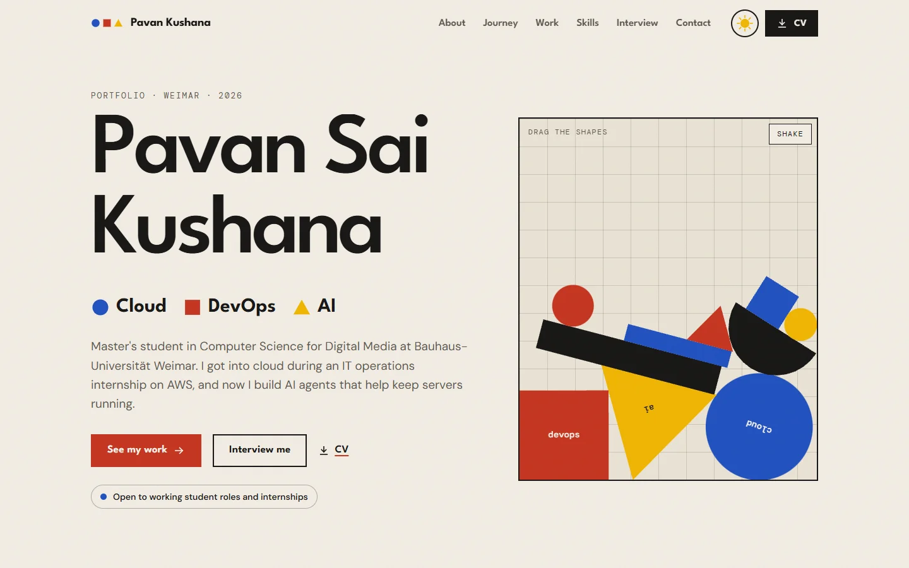
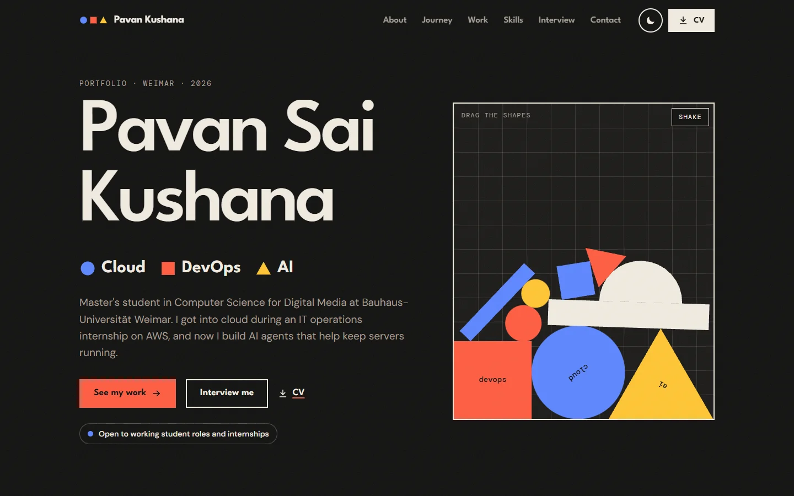

# Pavan Sai Kushana · Portfolio, Bauhaus edition

My personal website, designed after the Bauhaus, the school of design founded in Weimar, where I study. Kandinsky
paired a blue circle, a red square and a yellow triangle; here they stand for the three things I work on:
cloud, DevOps and AI. Light theme (paper) and dark theme (night).




## What's on the page

- **Hero:** shapes that fall in with real physics (matter-js); you can grab and throw them, or tap to shake on a
  phone. My name gets bolder where the cursor is (a variable font).
- **About:** my portrait in an arch, the three shapes drawing themselves, and four habits I work by
- **Journey:** a globe that turns from Hyderabad to Weimar while you scroll, drawing the trip (d3-geo)
- **Work:** an exhibition of posters that slides sideways; each opens a full case study
- **Skills:** tiles you can filter by shape; they glide to their new places (GSAP Flip)
- **Interview me:** tap a question and my real answer streams in, like a chat
- **Moments:** a collage of photo frames
- **Contact:** with the time in Weimar right now
- Light and dark theme: the switch grows as a circle across the page, and the choice is remembered
- The cursor turns into the shape of whatever it's over

## Change the text and add photos

Every word, link and photo slot is in [`src/content.js`](src/content.js). Photos go in `public/photos/`; the
[README there](public/photos/README.txt) says which frame wants which picture. Until a photo is set, its frame
shows a small composition of shapes and a label saying what goes there. Set `showPhotoLabels` to `false` to hide
the labels.

## Run it on your computer

```bash
npm install
npm run dev        # then open http://localhost:5173
```

## Check it before publishing

```bash
npm run build      # makes the finished site in dist/
npm run check      # tests dist/ in Chrome
```

`npm run check` opens the site in both themes at laptop and phone size, scrolls through it so every animation
runs, tries the theme switch, the skill filter, the interview and a case study, checks that nothing is wider
than a phone and that everything shows with "reduce motion" on, saves screenshots in `screenshots/`, and fails
if anything logs an error. It uses the Chrome installed on this laptop.

## Publish

`.github/workflows/deploy.yml` builds the site and puts it on GitHub Pages on every push to `main`. Once, on
GitHub: the repo's **Settings → Pages → Source: GitHub Actions**. All paths are relative, so any repo name or a
custom domain works. For a custom domain, add `public/CNAME` and change `VITE_SITE_URL` in `.env`.

The picture shown when the link is shared is `public/og-image.png`, made from `scripts/og-image.html` with
`node scripts/make-og.mjs`.

## Privacy and accessibility

No cookies, no analytics, no tracking. The fonts are part of the site (not loaded from Google), the YouTube
video loads only after someone presses play (from youtube-nocookie.com), and the map data is bundled. With
"reduce motion" switched on, nothing moves and everything shows. All text colours pass the WCAG AA contrast
guideline in both themes.

## Built with

- [React](https://react.dev) 19 and [Vite](https://vite.dev) 8
- [GSAP](https://gsap.com) (ScrollTrigger, Flip) and [Lenis](https://lenis.darkroom.engineering) smooth scrolling
- [matter-js](https://brm.io/matter-js/) for the physics, [d3-geo](https://d3js.org/d3-geo) and
  [world-atlas](https://github.com/topojson/world-atlas) (Natural Earth) for the globe
- [React Bits](https://reactbits.dev) VariableProximity (MIT + Commons Clause), in `src/components/reactbits/`
  (React Bits' licence in `LICENSE.md` there)
- Fonts: League Spartan, DM Sans and DM Mono (SIL Open Font License), through Fontsource
- Built with help from [Claude Code](https://claude.com/claude-code)
